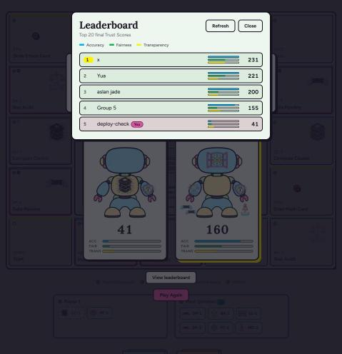

# Daily Report — 2026-11-08

The night before the presentation. Goal: get the live link showing the
current game. Online multiplayer stayed parked.

## What shipped

- **`master` moved from `911cb08` to `414f9f3`** (a fast-forward merge of
  `hard-mode`, which already contained `restyle` and `start-menu`, so there
  were no conflicts). All 51 tests passed after the merge. `master`,
  `restyle`, `start-menu` and `hard-mode` are all pushed to `origin`; nothing
  was force-pushed.
- **New live URL: https://build-a-brain-co-ten.vercel.app**, a new Vercel
  project (`build-a-brain-co`) in the owner's personal Vercel scope, deployed
  to production with `vercel deploy --prod` (status READY).
- What players get on the live site: the restyled board, the N-player start
  menu (Local 2-4, AI Mode 2-4 total players, Hard (preview), Online "Coming
  next"), and the live leaderboard.
- **Hard Mode ships as "Hard (preview)"**: the toughest tier-based AI, labeled
  honestly on the menu, the setup screen and in game. It makes no API calls
  and never claims web search (`HARD_MODE_AGENT_ENABLED = false`).
- Fixes made on the way, each with tests:
  - `buildPlayers` was dropping the seat's `usesAgent` flag, so the Hard Mode
    agent could never have been called in a real game (regression test added).
  - The agent now logs model errors (status and message only, key-shaped
    strings redacted) before falling back, so failures would show in Vercel's
    logs.
  - The agent no longer retries permanent errors (4xx other than 429).

## Verified on the live URL

- Loads with no Vercel login wall (HTTP 200). The deployment's own unique URL
  does redirect to a Vercel login; only the production URL should be shared.
- The live JavaScript bundle is the exact file tested locally
  (`index-BxDiMosa.js`): it contains "Hard (preview)" and no `/api/opponent`
  call.
- The new start menu with the restyle palette.
- Local (2 players), AI Mode (3 players) and Hard (preview) each started a
  game. One Hard (preview) game was played through all 3 laps to the Model
  Reveal. Chrome's network log showed **zero `/api/` requests**, and no
  search or failure text ever appeared.
- The leaderboard loaded (Supabase answered 200) and a real submit worked.

## Parked

- **Online multiplayer:** not built. The menu shows "Coming next", and the
  uncommitted `@supabase/supabase-js` install from the `online` branch is
  saved in `git stash` ("online-supabase-install").
- **Live Hard Mode agent:** built and unit-tested, but disabled. It has never
  answered a question live.

## What broke tonight

- **Stale `master`.** `master` was still at `911cb08`, from before the
  restyle and the start menu, and nothing had been pushed since then. Fixed
  by the merge and push above.
- **Wrong Vercel scope.** The old project lives in the `sikhay1` Vercel team,
  which this login can't access (`vercel whoami` said "Not authorized" inside
  the repo because of the old link). The old link was renamed to
  `.vercel_old/` (git-ignored, not deleted), and a new project was created in
  the personal scope. **The old URL, `build-a-brain-co.vercel.app`, still
  shows the old game** and is not maintained.
- **Supabase.** The handoff recorded Supabase as unreachable (a free-tier
  project pausing from inactivity was the suspected cause). Tonight it was
  reachable and working. *Unverified:* whether it had actually been paused,
  and whether anything was done to wake it.
- **Deprecated Gemini model.** The one live agent call returned
  `404 This model models/gemini-2.5-flash is no longer available to new
  users`. Google's pricing page, as read tonight, lists Search grounding on
  the suggested `gemini-3.8-flash` as "Not available" on the free tier (the
  same page's tools table contradicts this). The model was not switched; the
  agent was disabled instead.
- **GitHub login connection missing.** `vercel link` created the project but
  couldn't connect the GitHub repo ("You need to add a Login Connection to
  your GitHub account first"). **Pushing does not deploy**; redeploy by hand
  with `vercel deploy --prod`.
- **Only 1 of 6 live screenshots captured.** The browser's screenshot call
  kept timing out even though the page itself responded normally. The one
  that worked is `screenshots/live/leaderboard-after-submit.jpg`.
- `vercel link` also wrote a `VERCEL_OIDC_TOKEN` line into `.env.local` and
  added an `.env*` rule to `.gitignore`. A `!.env.example` line was added
  after it so the template stays visible to git. `.env.local` itself was
  never opened.

## Known limits

- **Leaderboard scores can be spoofed.** Scores are computed in the browser,
  so a determined visitor can submit a made-up score. Fine for a class
  project; a real leaderboard would need server-side validation.
- **Gemini free tier.** No free-tier rate limits are published for
  `gemini-3.8-flash` (Google says they're only visible in AI Studio), and
  search grounding for it isn't on the free tier per the model's own pricing
  row. Re-enabling the agent needs a working model, billing for grounding,
  and a fresh 3-question live test.
- Not phone-optimised (the board needs about 620 px of width).

## Unverified

- The Hard Mode agent answering a real question (never happened).
- The leaderboard's error state on the live site (Supabase was up, so it
  couldn't be triggered; the code does catch the failure and shows "Couldn't
  submit your score. Check your connection and try again.").
- Live screenshots of the start menu, the setup screens, an in-progress Hard
  (preview) game and the Model Reveal (not captured; see above).

## Live leaderboard test row

A test row, **`deploy-check`, score 41**, was submitted to the live
leaderboard to verify submitting works. The project owner is deleting it by
hand in the Supabase dashboard (the anon key can't delete rows). It was not
deleted from here.

## Completion status

- **Done:** merge, push, new Vercel project, production deploy, live checks
  above, docs (`README.md`, `DOCUMENTATION.md`), this report, and
  `DEMO_CHECKLIST.md`.
- **Tests:** 51 of 51 passing.
- **Not done:** live Hard Mode agent, Online multiplayer, GitHub
  auto-deploys, the remaining live screenshots.

## Screenshot (from the live URL)

